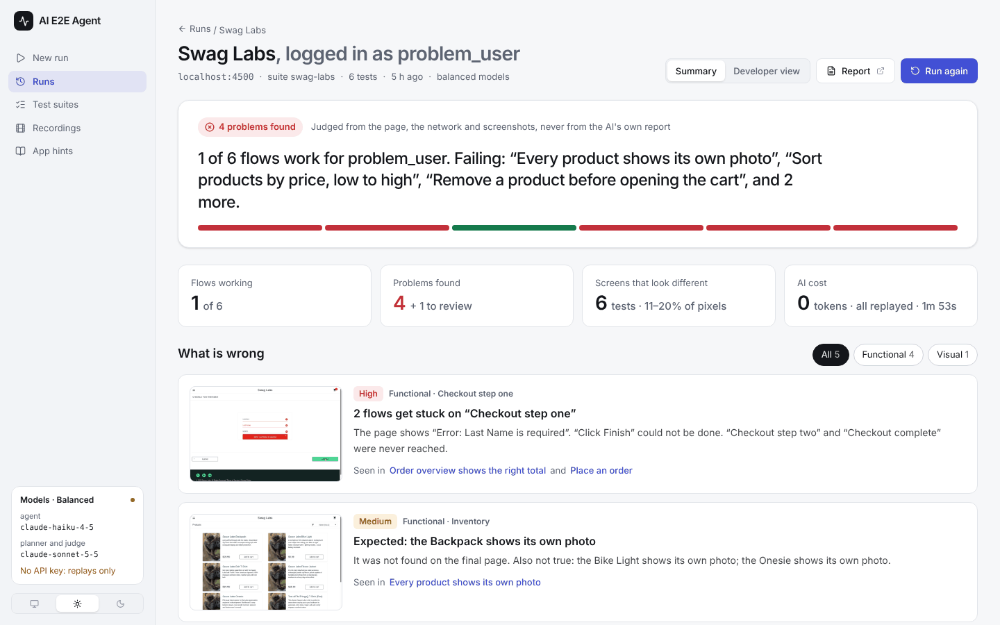
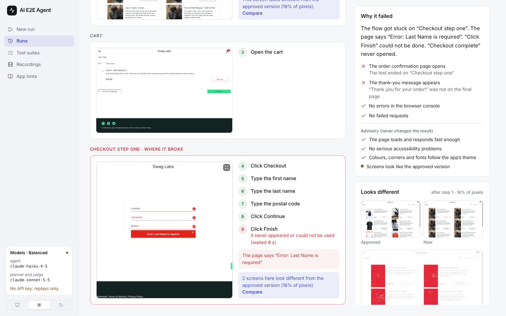
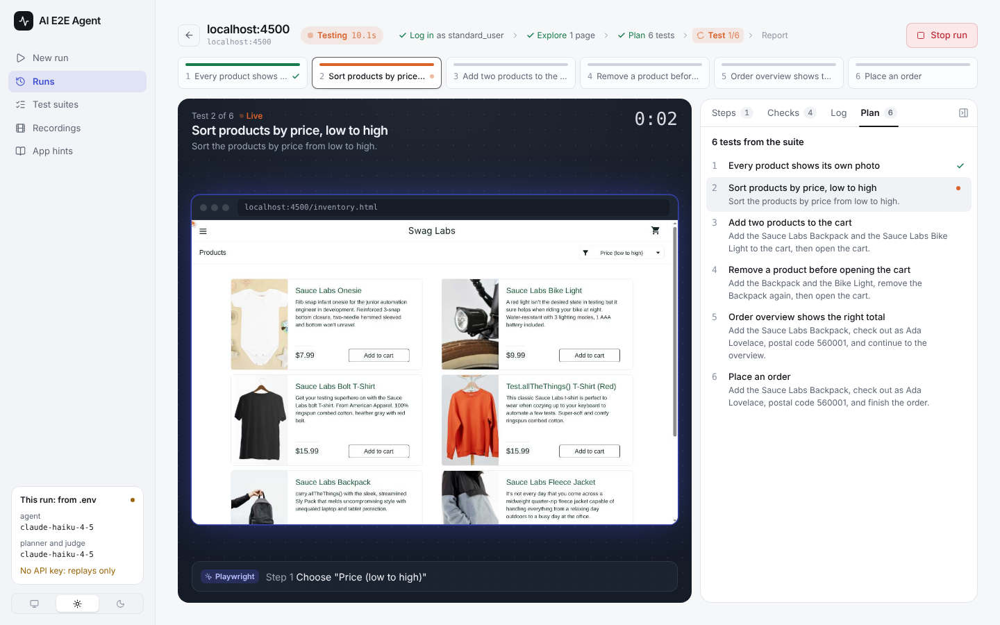

# ai-e2e-agent

AI-agent-driven end-to-end testing for any web app. Give it a URL: it explores the app, plans
user-flow tests, runs them with an AI agent driving a real browser, and **decides pass/fail from
evidence the agent cannot fake**: the page, the URL, network calls, downloads, toasts, console errors
and screenshots. Tests that pass are recorded and **replayed with plain Playwright and no LLM**. When a
replay breaks, the agent heals it, and every heal is logged.

> Final-round interview project. Status: working end to end, tested on three local apps (one with seeded bugs, two
> we did not write) and real deployed ones, checked in CI on every push, and running as a
> [live instance](https://ai-e2e-testing-agent.onrender.com/). How it is built: [Architecture](docs/ARCHITECTURE.md)
> and [Design](docs/DESIGN.md).

**Try it without installing:** the [live instance](https://ai-e2e-testing-agent.onrender.com/) (access code on
request) runs real tests on Render. A read-only static showcase can also be built (`npm run demo:export`, then
`npm run demo:build`).



## How it works

```
START → crawl → plan ──(one LangGraph branch per test)──▶ run test → write report → END

run test:   recording? ──yes──▶ replay with Playwright (no LLM) ──step breaks──▶ agent heals from here
               └──no──▶ AI agent drives the browser ──passes──▶ saved as a recording
            then: strict judge, from harness evidence only → pass / fail / error
                  failed? the judge's model explains the likely cause (advisory, after the verdict)
```

The AI agent is Stagehand 3.7's `agent()` by default, or our own loop (`--agent-engine loop`): the AI SDK's tool loop
on Playwright's accessibility tree, which takes any model and clicks the exact element it saw.

- **Strict judge.** It never trusts the agent's claim of success. It ignores checks that were already true
  before the agent acted. Visual checks compare the start, the run and the end. If the agent says it
  failed and only an AI reading of screenshots says otherwise, the test fails.
- **Quality on every test.** Core Web Vitals (`web-vitals`), accessibility (`axe-core`), API calls and slow
  endpoints, downloads, and transient messages, with a quality gate that can be off, warn or fail.
- **Theme conformance of your production build.** The themes your CSS ships (light, dark, brand themes as CSS
  variables) are discovered automatically. Every element on every screen a test reaches is checked in every theme,
  and Chrome reports the exact CSS rule behind each hard-coded value. Leaks such as a white card in dark mode are
  caught too, and buttons, links, inputs and headings are compared across screens to catch drift (a slightly
  different blue on one page). `--theme-from <url>` checks a product against another product's themes: are all
  your products on one theme?
- **Visual regression.** Deterministic screenshots of the final screen, each theme and each replayed step are compared
  pixel by pixel with approved baselines. The first passing run creates them; changes are approved or rejected in the
  UI. Mark changing content with `data-aie2e-mask`.
- **Your own tests, and apps behind a login.** Write suites in the UI (a goal in plain English plus checks), save
  any run as a suite, and run the same JSON in CI. Runs can log in first: credentials stay in `.env`, the session
  is shared by every test, and the AI never sees the password.
- **A report anyone can read.** The run summary says what works and what is wrong in plain words ("2 flows get stuck
  on Checkout step one. The page shows 'Error: Last Name is required'"), ranked by severity, with the screenshot that
  shows it. Each test is a journey: the pages the user went through, where it got stuck, the steps by page, and why
  it failed. Engineers get the full evidence one click away (Developer view).
- **Watch it live.** A local web UI streams the browser (CDP screencast) with a visible cursor while the run moves
  through log in, explore, plan, test and report.

## Try it

- **Run it yourself:** `npm install && npm run browsers && npm run ui` (see below).
- **Live instance:** [ai-e2e-testing-agent.onrender.com](https://ai-e2e-testing-agent.onrender.com/). It
  starts real runs on the owner's AI account, so it asks for an access code (ask me for it). It comes with
  finished runs to browse, and Sauce Demo, a seeded-bug shop and TodoMVC running next to it to test. How
  it is deployed and locked down: [Deploying](#deploying).

## What you see

| Test journey: where the user went and where it broke | Live run: the browser the agent is driving |
| ---------------------------------------------------- | ------------------------------------------ |
|     |        |

More screens: [the journey's flow strip](docs/images/ui-journey.png),
[problems by severity](docs/images/ui-summary-findings.png), [dark theme](docs/images/ui-journey-dark.png),
[what each part was given](docs/images/ui-who-did-what.png), [the New run page](docs/images/ui-new-run.png).

## Where AI is used, and where it is not

| Uses a model                                                                              | Never uses a model                                                             |
| ----------------------------------------------------------------------------------------- | ------------------------------------------------------------------------------ |
| **Planner**: tests and their checks from the crawl (one review round, then fixed by code) | Crawler, login, **replay** (plain Playwright)                                  |
| **Browser agent**: first runs and heals                                                   | **The verdict**: every hard check, "already true before the test acted", heals |
| **Judge**, only for `visual` questions about screenshots                                  | Accessibility, Web Vitals, theme audit, pixel comparison                       |
| **The AI's reading** of a failed test: likely cause, app bug or test problem, next step   | The report wording (plain English from the judge's own checks, no LLM)         |

Every test shows who did what: a filter on the journey (AI agent, Playwright, Judge) shows that part's steps and
its input, such as the exact instruction the agent got, the steps Playwright replayed and who wrote them, and the
checks the judge used. The suite editor is split the same way, so you can write the goal, the steps or the checks
yourself.

Model presets put strong models where calls are few: `economy` (haiku everywhere, for building), `balanced` (haiku
agent, sonnet-5-5 planner and judge) and `best` (sonnet-4-6 agent, opus-5-5 planner and judge, for demos). A preset
picked for a run beats the models in `.env`; every run logs its models first.

## Quick start

```bash
npm install
npm run browsers            # Playwright's Chromium (or it uses your installed Chrome/Edge)
cp .env.example .env        # add ANTHROPIC_API_KEY; AIE2E_PRESET=economy keeps development cheap
npm run doctor              # checks Node, Chromium, API key

npm run ui                  # web UI at http://localhost:4173: start runs, watch live, browse results
```

Try it on the demo apps (they run locally; replays need no API key):

```bash
npm run shop                # :4300, a shop with 12 switchable bugs (BUGS=none for the clean app)
npm run todomvc             # :4400, the React TodoMVC build
npm run saucedemo           # :4500, Sauce Labs' demo shop; bugs depend on who logs in

npm start -- run http://localhost:4300 --suite examples/buggy-shop/suite.json --no-heal
npm start -- run http://localhost:4400 --suite examples/todomvc/suite.json --no-heal
# Sauce Demo needs AIE2E_USERNAME (standard_user, problem_user, ...) and AIE2E_PASSWORD=secret_sauce
npm start -- run http://localhost:4500 --suite examples/saucedemo/suite.json --no-heal
```

CLI:

```bash
# AI explores and plans (the first run records, later runs replay); best models for this run
npm start -- run https://your-app.test -d "What the app is, in one sentence" -c 2 --preset best

# our own agent loop with any model as the agent
npm start -- run https://your-app.test --agent-engine loop --model anthropic/claude-sonnet-5-5

# one flow, in plain English
npm start -- run https://your-app.test --goal "Add a product to the cart and check out" --expect-text "Thank you"

# no AI at all: smoke check (errors, Web Vitals, accessibility)
npm start -- run https://your-app.test --no-plan

# a committed suite (tests with recorded steps replay with no LLM); --no-heal makes it CI-strict
npm start -- run http://localhost:4300 --suite examples/buggy-shop/suite.json --no-heal

# visual regression: warn (default) | fail; accept the current screenshots as the new baselines
npm start -- run http://localhost:4300 --suite examples/buggy-shop/suite.json --visual fail
npm start -- run http://localhost:4300 --suite examples/buggy-shop/suite.json --update-baselines

# is this product on the same theme as our design-system site? (values compared, not variable names)
npm start -- run https://app-two.your-company.com --theme-from https://design.your-company.com

# an app behind a login (username/password from AIE2E_USERNAME / AIE2E_PASSWORD in .env)
npm start -- run https://staging.your-app.com --login-url /login --login-success-text "Welcome back"

# turn any run into a suite you can commit
npm start -- export <runId> -o my-app.suite.json
```

Exit codes: `0` all passed, `1` a test failed, `2` an error occurred. Reports: `.aie2e/runs/<runId>/report.html`
(self-contained, light/dark) and `report.json`.

## Evaluation

`examples/buggy-shop` is a small shop with 12 switchable, known bugs (functional, error, accessibility, performance,
theme, consistency and visual). `npm run eval` runs the clean app
several times and then each bug on its own:

> **12/12 seeded bugs detected (incl. 3 theme, 1 consistency and 1 visual-only bug) · 0 false positives over 3 × 7 clean tests · 0 flaky tests** (committed suite,
> no LLM). `npm run eval` prints the per-bug table and writes it to `.aie2e/eval/EVALUATION.md`.
> `npm run eval -- --mode explore --heal` measures the full AI path (planner + agent).

The same suite format works on an app we did not write: `examples/todomvc` (the React TodoMVC build) passes
6/6 with no LLM, each injected regression fails exactly the test it should, and the quality gate found a real
accessibility issue in TodoMVC itself (unlabelled checkboxes).

`examples/saucedemo` is Sauce Labs' demo shop, built locally from its MIT source: a real app with a login whose
bugs depend on who logs in. The same 6-test suite passes as `standard_user` and fails for the right reasons as
`problem_user`, `error_user` and `visual_user`; `performance_glitch_user` passes with slow-page warnings and
`locked_out_user` stops at login. 0 tokens after the first recording: see
[examples/saucedemo/README.md](examples/saucedemo/README.md).

**The AI path** (planner + agent) varies from run to run and costs tokens. Measured on the seeded-bug shop before the
plan review existed: 2/6 seeded bugs, 3 false positives; the plan
review, section-named controls and plain-words checks were built from exactly those failures. Since then, one
exploratory run on the deployed instance with all 12 bugs switched on (Balanced models, 4 planned tests, 3½
minutes) found 7 of them blind, with 1 false alarm (a check that assumed how search results are shown).

On a real deployed app (Asset Sense, `--preset best`), the planner named each "Explore Now" by its section,
the agent reached the right pages, and the run found the app's own bugs: React hydration errors on every page, a
request to `/[object Module]` that returns 404, and a community page that never loads. When the agent clicked the
wrong one of three identical buttons and called it success, the judge failed it from the URL and the screenshots,
and the AI's reading said it was a problem with the test, not the app. On TodoMVC both agent engines pass the same
goal; Stagehand + haiku-4-5 used 47k tokens, the own loop + sonnet-5-5 106k (it recovered from its own mistake and
said so).

CI runs every demo suite on each push: the clean apps must pass, and a seeded regression in each (the shop's
wrong total, TodoMVC's broken "Clear completed", Sauce Demo's `problem_user`) must fail. See
`.github/workflows/ci.yml`.

## Use it in your CI (GitHub Action)

The repo root is a GitHub Action. A committed suite replays with plain Playwright (no AI, no API key); the job fails
when a test fails, the HTML report is uploaded and a summary table appears on the job page.

```yaml
- uses: Roh4n-1729/AI-E2E-Testing-Agent@main
  with:
    url: http://localhost:3000
    suite: tests/e2e/app.suite.json # written in the UI or with `aie2e export <runId>`
    visual: fail # optional: a screenshot that differs from its baseline fails the PR
    baselines-dir: tests/visual-baselines # optional: approved screenshots committed with the code
  env:
    ANTHROPIC_API_KEY: ${{ secrets.ANTHROPIC_API_KEY }} # only for tests with no recording yet, or heal: 'true'
```

Other inputs: `heal`, `quality`, `theme-from`, `login-url`, `login-success-text`, `concurrency` (see `action.yml`).
Outputs: `passed`, `failed`, `report`. Inputs reach the script as environment variables, never pasted into it, so a
suite path or URL cannot inject shell commands.

## Optional app hints

Nothing is required: without hints the agent works from what it sees and recordings use XPaths. A few attributes
make runs cheaper and replays sturdier (types for JSX autocomplete: `types/aie2e-attributes.d.ts`):

| Attribute                                    | What changes                                                              |
| -------------------------------------------- | ------------------------------------------------------------------------- |
| `data-testid` (or `data-test`, `data-cy`, …) | Recordings use it instead of an XPath, so replays survive layout changes  |
| `aria-busy="true"`                           | The harness waits for it to clear before the next step and before judging |
| `data-aie2e-hint="…"`                        | Free text for the planner and agent ("Enabled only after a title is set") |
| `data-aie2e-reveal="hover"`                  | A control hidden until hovered; the agent can hover it by test id         |
| `data-aie2e-mask`                            | Painted over in visual-regression screenshots (timestamps, live counters) |
| `data-aie2e-component="PrimaryButton"`       | Every element with this name must look the same on every screen and theme |
| `data-aie2e-ignore-theme`                    | Left out of the theme audit (third-party widgets)                         |

## Deploying

`Dockerfile` + `deploy/serve.js` run the UI with Chromium and the three demo apps in one container (Render, 1 CPU /
2 GB, health check `/healthz`). Set `ANTHROPIC_API_KEY`, `AIE2E_ACCESS_CODE`, and optionally `AIE2E_PRESET`,
`AIE2E_USERNAME`, `AIE2E_PASSWORD`. `npm run deploy:seed -- --runs <ids>` bakes finished runs into the image.

The instance starts browsers and AI calls on the owner's account, so it is locked down in code
(`src/server/access.js`, tested in `tests/access.test.js`):

| Guard       | What it does                                                                                         |
| ----------- | ---------------------------------------------------------------------------------------------------- |
| Access code | Every API call needs it; 10 wrong codes lock a visitor out for 10 minutes. No code: localhost only   |
| Host names  | Only the service's own host name (`AIE2E_ALLOWED_HOSTS`, filled from Render)                         |
| Targets     | Nothing on the server's own machine or network, checked after DNS; the demo apps are the exception   |
| Login       | The demo password is only typed into a listed app, never one a visitor chooses, even through a suite |
| Size        | At most 4 planned tests, one test at a time, one run at a time, never headed                         |

## Stack

Node 22, JavaScript (ESM) + JSDoc types checked by `tsc`. Why each library:
[docs/ARCHITECTURE.md](docs/ARCHITECTURE.md#libraries-all-open-source). Licences as shipped in the installed
packages:

| Library                                       | Used for                                    | Licence    |
| --------------------------------------------- | ------------------------------------------- | ---------- |
| Stagehand 3.7                                 | the AI browser agent (default engine)       | MIT        |
| Playwright 1.64                               | browser control, replay, evidence           | Apache-2.0 |
| LangGraph JS 1.5                              | orchestration (crawl → plan → run → report) | MIT        |
| Vercel AI SDK 5 (+ Anthropic, OpenAI, Google) | planner, judge, explainer, own agent loop   | Apache-2.0 |
| zod 4                                         | schemas for suites, recordings, reports     | MIT        |
| axe-core 4                                    | accessibility checks                        | MPL-2.0    |
| web-vitals 5                                  | Core Web Vitals                             | Apache-2.0 |
| culori 4                                      | colour maths for theme checks (ΔE)          | MIT        |
| pixelmatch 7 + pngjs 7                        | visual diffs                                | ISC, MIT   |
| Fastify 5                                     | local server + SSE                          | MIT        |
| React 19, Tailwind v4, Radix UI, Vite 7       | web UI                                      | MIT        |
| Commander, dotenv                             | CLI, `.env`                                 | MIT, BSD-2 |
| Vitest 3                                      | tests                                       | MIT        |

## Honest limits

- Login is username + password (one form, two steps, or scripted steps). No OTP/2FA or SSO consent screens
  unless you script them; one shared session per run.
- UI testing only: no API or backend test generation.
- Runs locally, in CI, or as one locked-down deployed instance ([Deploying](#deploying)): one run at a
  time, one test at a time there, and runs made on it are lost when it restarts. No run video; each step's
  screenshot is kept instead.
- AI-planned checks can carry a wrong assumption about how the app shows a result (a search that prints "Found:
  Notebook" above the full list was expected to narrow the list). The judge then fails a working flow; the
  AI's reading can agree with the wrong check. Review planned tests before keeping them as a suite.
- The visual judge is an LLM. It sees screenshots from the whole run, but deterministic checks (text, URL, test id, API
  call, download) are always stronger and the planner prefers them.
- The committed-suite numbers are replays (0 tokens, deterministic). The AI path (planner + agent) varies from
  run to run and costs tokens: `npm run eval -- --mode explore --heal` measures it.
- Real apps make third-party noise (fonts, analytics, error reporters). It fails the console and network guards
  until a suite declares it in `ignore`; the requests still show in the evidence.
- On Linux the agent's Chrome runs without Chrome's own sandbox, as Playwright's browsers do by default (CI runners
  cannot start it otherwise). Test apps you trust, or set `AIE2E_CHROME_SANDBOX=true` where the sandbox works.
- Stagehand 3.7.3's agent cannot drive the 5.5 models (thinking-signature error): the presets use haiku-4-5 or
  sonnet-4-6 there. Our own loop (`--agent-engine loop`) takes any model but is newer: one real comparison so far.
- The AI's reading of a failure is an LLM's interpretation: it is labelled, it never changes a result, and it costs
  one call per failed test (none on a green run; `--no-explain` turns it off).

## Docs

- [Architecture](docs/ARCHITECTURE.md): the parts, how a run flows through them, and where each one lives.
- [Design](docs/DESIGN.md): every decision with its reason, and the alternatives that were not built.
- [Contributing](CONTRIBUTING.md): commands, the rules every change keeps, and where things go.

## Credits

Ideas, not code, from: Playwright Test Agents (planner / generator / healer), Octomind (record and self-heal),
Magnitude (vision-first agents), [Flowtrace](https://github.com/57hemanth/flowtrace) (plain-English tests run
by an agent on Playwright), and TestSprite (result presentation).

Demo apps we did not write, served from production builds of their unmodified source with their licences next
to them: [TodoMVC (React)](https://github.com/tastejs/todomvc) (MIT) and
[Swag Labs / Sauce Demo](https://github.com/saucelabs/sample-app-web) (MIT).
