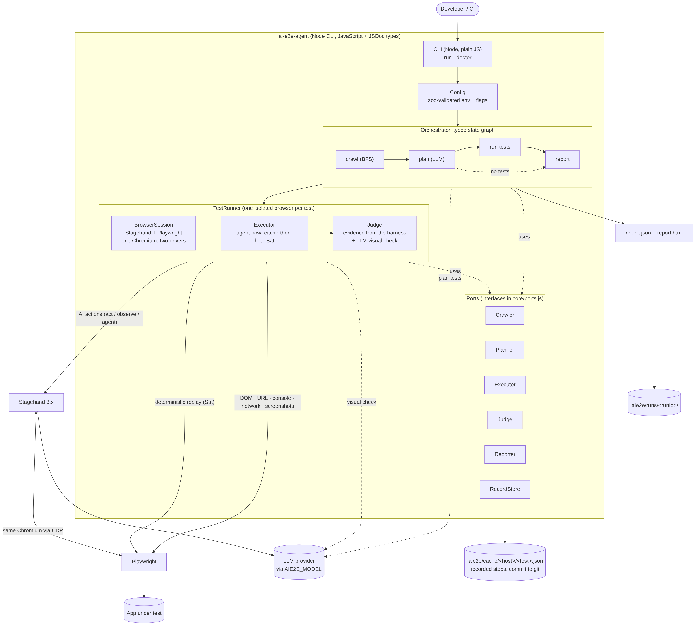
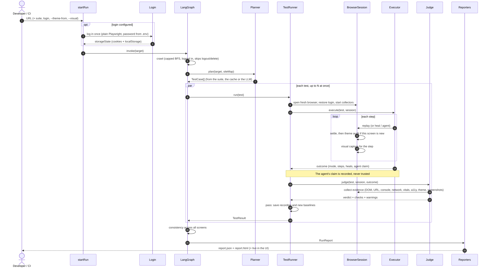
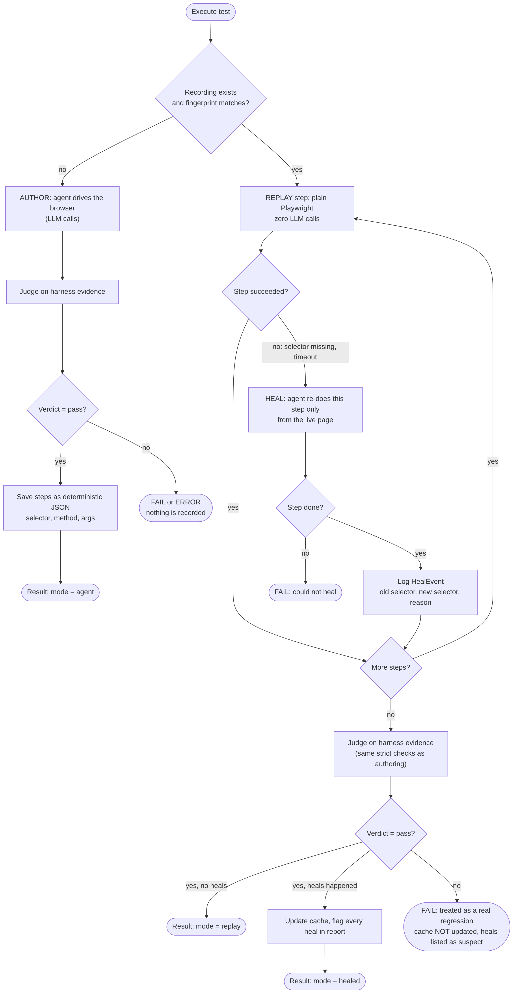
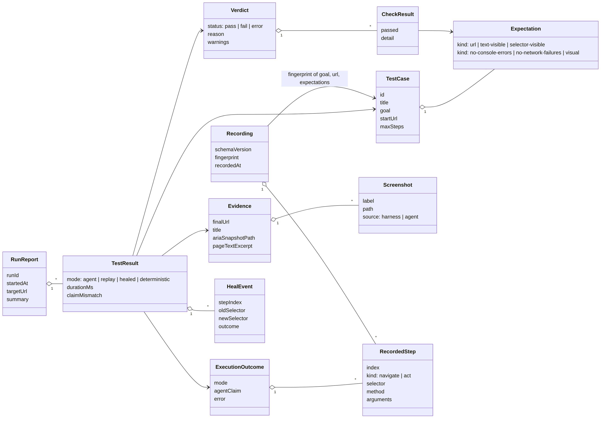

# Architecture

Given a URL (plus an optional description), the tool plans test cases for user flows, runs them with
AI agents driving a real browser, judges pass/fail from independent evidence, and reports.
It is generalised: nothing in `src/` knows about a specific app.

**Core idea:** agents _author_ and _repair_ tests; plain Playwright _replays_ them. A successful
agent run is recorded as deterministic JSON steps and replayed with zero LLM calls. A failed step
falls back to the agent (self-healing) and updates the cache, and every heal is logged.

## 1. Components



Layers, outermost first:

| Layer             | Path                                   | Rule                                                                |
| ----------------- | -------------------------------------- | ------------------------------------------------------------------- |
| CLI and UI        | `src/cli`, `src/server`, `ui/`         | Parse input, start a run, stream events. No test logic.             |
| Run setup         | `src/app/startRun.js`                  | Config, login once, theme reference, baselines; builds the graph.   |
| Orchestrator      | `src/core/pipeline.js`                 | LangGraph: crawl, plan, runTest (fan-out), writeReport.             |
| Ports             | `src/core/ports.js`                    | Interfaces: Crawler, Planner, Executor, Judge, Reporter, Store.     |
| Adapters          | `crawler/ planner/ executor/ judge/ …` | One implementation per port. Swap without touching the graph.       |
| Browser           | `src/browser/session.js`               | The only place that touches Stagehand and Playwright directly.      |
| Checks            | `src/theme`, `src/visual`, `src/auth`  | Theme audit, consistency, visual baselines, login. Pure evidence.   |
| Domain + contract | `src/core/types.js`                    | Zod schemas are the source of truth for every persisted/JSON shape. |

## 2. Run lifecycle



Each test gets its own Chromium (isolation first; pooling is an optimisation we skip).
The judge runs even when the executor throws, so a crash is reported with evidence. Tests run in parallel with `--concurrency N` (bounded pool, one Chromium each).

## 3. Record, replay, heal



Implementation seam: `CachingExecutor` is a **decorator** around `AgentExecutor`
(`Executor` port). It loads a `Recording`, replays with Playwright locators, and on a step failure
calls the wrapped agent for that single step. Nothing else in the codebase changes.

Anti-masking rules (these are the point of the project):

1. A heal never changes the verdict. The judge decides on the final evidence, same checks as authoring.
2. If the judge fails after a heal, the cache is **not** updated and the heals are listed as suspect.
3. Every `HealEvent` (old selector, new selector, reason) is in the report.
4. A recording is invalidated when its fingerprint (goal + startUrl + expectations) changes.

### Judge rules added after the first real runs (29 Oct)

- **Vacuous expectations do not count.** The harness snapshots the start page before the agent acts
  (`BrowserSession.baseline`). An expectation already true there is marked `vacuous`; a goal test
  needs at least one non-vacuous passing outcome check, else it fails as "Inconclusive". This caught
  planner expectations such as `url includes "presentation"` (matched the hostname) and generic words.
- **Recordings are written only by runs the judge passed.** A replay that completes but fails the judge is
  re-checked by the agent from scratch; if the agent also fails the judge the failure stands (no masking).
- **Plans are cached** (`planner/cachedPlanner.js`) so test ids stay stable and recordings can hit.

## 4. The strict judge

The agent says "done" and may be wrong. The judge never reads that claim for the verdict. The
harness collects evidence through Playwright, a driver the agent does not control: final URL,
aria snapshot, visible text, console errors, failed network requests, and screenshots. Expectations
are checked against that. `TestResult.claimMismatch` flags any disagreement between claim and
verdict, which is itself a signal worth showing in the report.

`visual` expectations ask an LLM a yes/no question about a screenshot the **harness** takes at
judging time, never the agent's own frames. With no LLM available the check fails loudly instead of
passing silently. `LlmPlanner` always emits a deterministic smoke test first, then up to
`--max-tests` AI-planned flows grounded in the crawl summary. Planner failures abort the run
instead of silently degrading.

## 4b. Quality evidence and live view (29 Oct, evening)

Found by running on a real app: all three failures of the 12:47 run were bad _test specs_, not bad agent
behaviour (planner-guessed URL fragments `/presentation`, `slideshow`, `download`; and a download toast that
had vanished before the end-of-test screenshot). So the judge got more independent senses, and the planner
less room to guess.

| Signal                                                                    | Where                   | How the judge uses it                                                  |
| ------------------------------------------------------------------------- | ----------------------- | ---------------------------------------------------------------------- |
| fetch/XHR log (method, url, status, duration, bytes)                      | `browser/collectors.js` | `api-call` expectation; slow-API warning; request totals in the report |
| File downloads (Playwright `download` event, saved under the test folder) | collectors              | `download` expectation (name/extension)                                |
| Transient messages (MutationObserver on toasts / alerts / live regions)   | collectors              | `text-appeared` expectation, true even if the toast is gone at the end |
| Core Web Vitals (Google `web-vitals`: LCP, CLS, INP, FCP, TTFB)           | collectors              | `web-vitals` budgets                                                   |
| Accessibility (axe-core, WCAG 2.x A/AA) on the final page                 | collectors              | `no-a11y-violations` (min impact)                                      |

- **Quality gate** (`--quality off|warn|fail`, UI select, `AIE2E_QUALITY_GATE`): Web Vitals + accessibility run on
  every test. `warn` (default) marks the checks _advisory_: shown, never change the verdict. `fail` makes a breach
  fail the test. Budgets default to Google's "poor" thresholds so only clear problems trip.
- **Vacuity applies to API calls too**: a matching request already made before the agent acted proves nothing.
- **Planner grounding**: `url-contains` and `api-call` are kept only if the value appears in the crawl (links, or
  API calls seen on load); otherwise dropped and logged. If nothing is left, a visual question about the goal is used.
- **Hover-revealed controls**: the agent has a `hoverAt(xPercent, yPercent)` tool (real pointer movement). It is
  recorded as a `mouse` step with viewport percentages, so replay works at any window size.
- **Cursor**: eased glide (distance-scaled, rAF) instead of jumping; last position kept across navigations.
- **Live view**: CDP `Page.startScreencast` (JPEG pushed on every repaint, capped at 30 fps, only while a viewer is
  connected; follows the front tab; idle pages re-sent every ~1.5 s) instead of polling screenshots at 4 fps.

Not covered yet (be honest in the README): cross-browser, mobile viewports, visual regression baselines,
authenticated flows, load/security testing, exploratory "does this feel right" judgement.

## 4c. Judging rules added from the 13:19 run, app hints, libraries

Each rule came from a real run that passed or failed for the wrong reason first.

- **Visual checks see a timeline** (start, up to 3 run frames, now), never a single screenshot.
- **Asymmetric trust:** a success claim is never trusted; a failure claim is believed unless deterministic
  evidence (URL, text, test id, API call, download, toast) contradicts it.
- **Settle before evidence:** start screenshots only after the page renders; final evidence only after the app
  goes quiet (text stable, no `aria-busy`, no fetch/XHR in flight).
- **Heals are labelled by the judge**, not by the agent.
- **Optional app hints** (README, "Optional app hints"): test ids become recorded selectors with XPath fallback.
- **Run log (`trace`)**: every agent or replay step with the screenshot taken after it, rendered as the step
  timeline in the UI and the HTML report.
- **Per-role models:** `AIE2E_PLANNER_MODEL` / `AIE2E_JUDGE_MODEL`; planner and judge tokens reported as overhead.

### Libraries (all open source)

| Job                                    | Library                                                                               | Why this one                                                                                                                                     |
| -------------------------------------- | ------------------------------------------------------------------------------------- | ------------------------------------------------------------------------------------------------------------------------------------------------ |
| Browser agent                          | Stagehand 3.7.3 (MIT)                                                                 | Best JS option with DOM-mode act/observe/agent and evidence callbacks. Browser Use is Python, Magnitude is vision-first and less mature in JS.   |
| Deterministic driver, replay, evidence | Playwright 1.64 (Apache-2.0)                                                          | The standard.                                                                                                                                    |
| Structured LLM calls                   | Vercel AI SDK 5 (Apache-2.0)                                                          | Provider-neutral, zod schemas.                                                                                                                   |
| Accessibility                          | axe-core (MPL-2.0)                                                                    | The de-facto engine (also inside Lighthouse).                                                                                                    |
| Web Vitals                             | web-vitals (Apache-2.0)                                                               | Google's reference implementation.                                                                                                               |
| Orchestration                          | LangGraph JS 1.5.3 (MIT)                                                              | `StateGraph` + `Annotation` + `Send` fan-out (§4d). Concurrency capped by our own limiter (LangGraph's `maxConcurrency: 1` drops Send branches). |
| Server                                 | Fastify 5 + @fastify/static (MIT)                                                     | Fast, schema-friendly, SSE via raw reply.                                                                                                        |
| UI                                     | React 19, Tailwind v4, Radix UI, lucide, sonner, yet-another-react-lightbox (all MIT) | The shadcn approach without the generator: accessible primitives, our tokens.                                                                    |
| Validation, CLI                        | zod 4, commander (MIT)                                                                |                                                                                                                                                  |

Considered and not used (yet): Lighthouse (heavier than needed when web-vitals and axe already cover it),
pixelmatch for deterministic before/after diffs (roadmap), Playwright `recordVideo` (not available on a
CDP-attached context; the screencast and step screenshots cover it).

## 4d. LangGraph, suites and evaluation (29 Oct, night)

```
START → crawl → plan ──Send(test)──▶ runTest (× N, `concurrency` at a time) → writeReport → END
                  └──── no tests ─────────────────────────────────────────────▶ writeReport
```

- `core/pipeline.js` builds a real `@langchain/langgraph` `StateGraph`. `results` uses an append reducer, so the
  parallel branches merge, and the report sorts back into plan order. `npm run graph` exports the Mermaid diagram.
- `planner/suitePlanner.js`: committed suites (relative URLs, optional recorded steps → seeded recordings;
  saved recordings win so heals persist). `aie2e export <runId>` writes one from a run.
- `--no-heal`: replay failures are verdict "fail" via `outcome.failure`, with no agent involved.
- `examples/buggy-shop` + `scripts/evaluate.js` (`npm run eval`): clean runs, then one bug at a time; results in
  `.aie2e/eval/EVALUATION.md`.

## 4e. Theme conformance on every screen, and consistency (30 Oct)

- `src/theme/states.js`: `stateFingerprint` (in-page) identifies a screen by route, open overlays, landmarks and
  visible test ids, never text. `ThemeStates` is created once per run (`startRun` → `TestRunner` →
  `BrowserSession.open`). It audits each screen once, shares the result across tests (`reusedFrom`), and caps
  fresh audits.
- `BrowserSession.auditState(label)`: replay calls it after every step; the agent calls it on Stagehand's
  `step_observed` event, when the agent is paused. The fingerprint is checked first (cheap). Only a new screen
  is settled and audited, scroll-safe. `collectEvidence` audits the final screen the same way, and
  `evidence.themeStates` lists them all. `evidence.theme` stays the final screen's audit.
- `src/theme/consistency.js`: `analyseConsistency(results)` runs in `writeReport` over each screen once, using the
  component inventory (`ThemeResult.inventory`). It produces `report.consistency`: near-duplicate looks and
  `data-aie2e-component` variants. Advisory; rendered in the run summary (UI) and the HTML report.

## 4f. Visual regression (30 Oct)

- Capture: `BrowserSession.visualCapture(checkpoint)` takes a masked, cursor-free, animation-finished viewport
  screenshot into `<test>/visual/`. Replay captures after every step (`stepCheckpoint` = index + hash). The
  final screen is captured once plus once per theme (`collectEvidence`). Result: `evidence.visual.captures`.
- Compare: `EvidenceJudge` (given a `BaselineStore`) runs `compareCaptures`. Each capture gets a status:
  new / unchanged / changed / size / error. The diff and a baseline copy are written next to the capture. Under
  the visual gate the judge adds a `visual-baseline` check (advisory in warn mode).
- Persist: `TestRunner` saves "new" captures of passing tests as baselines (and everything with
  `--update-baselines`). The server's `POST /api/runs/:id/visual` approves or rejects one screenshot later.
- `summary.visualChanges` / `visualNew` feed the UI and report.

## 4g. Suites in the UI and login (30 Oct)

- `src/server/suites.js` (`SuiteStore`): suite JSON files; the `/api/suites` routes; `from-run` uses
  `suiteFromRun`. `POST /api/runs { suite: name }` resolves the file. The UI screen is `ui/src/screens/Suites.jsx`.
- `src/auth/login.js`: `AuthSchema` (in suites, run options, CLI and server), `performLogin` (Playwright, once per
  run in `startRun`, before the pipeline), `applyStorageState` (cookies + localStorage init script for the
  Stagehand-owned context in `BrowserSession.open`). The crawler gets the state via `newContext({ storageState })`.
  `AgentExecutor.loggedIn` adds "do not log out" to the instruction. `report.auth` records the username, never
  the password.

## 4h. Theme conformance across products (30 Oct)

- `src/theme/reference.js` `captureReference(url)` runs once in `startRun` (like login) and produces a
  `ThemeReference` (themes → resolved colours, lengths and fonts). It reaches the audit via `TestRunner` →
  `BrowserSession.open({ themeReference })` → `auditState` → `auditThemes({ reference })`. In reference mode the
  audit takes tokens from the reference (same theme id, else its base), ignores the target's own `var()` usage,
  marks misses `off-reference`, and audits theme-less targets in their default look.

## 4i. Planner review loop (30 Oct, from the first full-AI evaluations)

The planner is the weakest link, so its output is checked before any test runs (`reviewExpectations` in
`planner/llmPlanner.js`): text checks are compared with what the crawler saw. Start-page text (proves nothing),
wording the crawl never showed (a guess) and URL checks already true at the start are flagged; a changed number in
text the crawl saw ("Cart (2)" vs "Cart (0)") is allowed. Findings go back to the planner for exactly one revision;
what is still wrong is repaired deterministically (dropped, or turned into a yes/no question about the
screenshots). Generator → deterministic critic → one revision: bounded cost, no infinite loops.

Suites from third-party apps declare their noise (`ignore: { network, console }`), and seeded-bug runs in the
evaluation never approve screenshots (`visual.saveNew: false`), so a bug can never become the baseline.

## 4j. Reading a run: insights and UI v2 (30 Oct)

```
report.json ──▶ reporter/insights.js (pure, no LLM) ──▶ web UI summary + journey
                 headline, findings, per-test outcome     report.html verdict + findings
                 and page flow, checks in words           run list headline
```

`runInsights(report)` derives everything a non-developer reads from the judge's own checks: a headline, findings
grouped by what they mean (tests stuck on the same page are one finding; console and network errors are grouped by
message across tests; visual changes, AI-claim disagreements and heals are "review" or "low", never hidden), and
per test the pages it went through (from the trace URLs, plus the expected pages it never reached), the step that
broke and any error the page itself shows. Checks are said by their `label` when they have one (D28). Nothing in
it can change a verdict (D27). The UI shows the summary first and keeps the developer tabs one click away (D29).

After the verdict, failed tests get one more call (D30): `judge/failureExplainer.js` sends the judge's model the
failed checks in words, the steps by page, the final page text, console errors, failed requests and up to three
screenshots, and stores `result.explanation` (cause, category, confidence, evidence, suggestion). Insights attach
it to the matching finding; the UI and `report.html` show it as "AI's reading". The order is the guarantee: the
verdict exists before the explainer is asked.

### Where AI is used, and where it is not

| Uses a model                                   | Never uses a model                                       |
| ---------------------------------------------- | -------------------------------------------------------- |
| Planner (tests and checks, one revision)       | Crawler, login, replay                                   |
| Browser agent (first runs, heals)              | Every hard check, vacuity, plan review, heal acceptance  |
| Judge: `visual` questions only                 | Accessibility, Web Vitals, theme audit, pixel comparison |
| Failure explainer: failed tests only, advisory | Insights and report wording (D27)                        |

### Two agent engines (D31)

`config.agentEngine` picks the executor in `startRun`: `AgentExecutor` (Stagehand `agent()`) or
`LoopAgentExecutor` (AI SDK `generateText` with tools, `stopWhen: [stepCountIs(maxSteps), hasToolCall('finish')]`).
Both take the same `(test, session, ctx, resume)` and return the same `ExecutionOutcome`, so replay, healing, the
judge and the reports do not know which one ran. The loop's tools act on `aria-ref` locators from the latest
snapshot and record `locator.normalize()` selectors.

## 4k. Watching a run, and who did what (31 Oct)

- **Live stage.** SSE events carry their time (`at`); the browser frame is coloured by state, the current step
  is laid over it with its actor, and a `test.judging` event (emitted by `testRunner` between the executor and
  the judge) hands the overlay to the judge. `hooks/useFollow.js` keeps the step list and the run log on the
  newest line only while the reader is at the bottom.
- **Run log.** Level filter with counts, "only this test" (logger scope = test id), search, copy, 1000 lines.
- **Inputs per part.** `testInputs(outcome)` stores what the agent was given (model, engine, instruction) and the
  steps Playwright ran with their source (`suite`, `recording`, `agent`, `harness`) on each result
  (`result.inputs`, D33). The journey filters by part; the suite editor is split by part.
- **Saved plans** are keyed by URL, description, planner model, test count and `PLANNER_VERSION` (a hash of the
  planner's instructions); a reused plan is announced (`plan.reused`).

## 4l. Deployment (D34)

```
Render (Docker, 1 CPU / 2 GB)
└─ deploy/serve.js
   ├─ Sauce Demo :4500, buggy shop :4300, TodoMVC :4400   (127.0.0.1 only)
   ├─ copies deploy/seed (baked runs, recordings, plans, baselines) into .aie2e on first start
   ├─ installs the demo apps' suites
   └─ node src/cli/main.js ui --host 0.0.0.0 --port $PORT
        └─ server/access.js: code cookie · host allow-list · no private targets (after DNS)
                             · .env login only on listed apps · ≤ 4 tests, 1 at a time
```

`/healthz` answers before the host check (the platform's probe). Locally nothing changes: the server binds to
127.0.0.1 and refuses to listen elsewhere without `AIE2E_ACCESS_CODE`.

## 5. Data model



## 6. Decisions

The main choices, in short. Every decision, numbered with its reason, and the alternatives that were not
built are in [DESIGN.md](DESIGN.md).

- UI components are hand-written shadcn-style primitives (Tailwind v4 tokens), not generated by the shadcn CLI (no network in the build sandbox). Same look, no generator dependency.

| Decision                                                          | Why                                                                                                                                                    |
| ----------------------------------------------------------------- | ------------------------------------------------------------------------------------------------------------------------------------------------------ |
| **Stagehand pinned to 3.7.3** (`v3-latest`), not v4               | v4 (4.x) has a different `Stagehand.create()` API and no `agent()` export. v3 has `agent()`, `onEvidence`, `connectURL()`. Revisit after the deadline. |
| Stagehand launches Chromium, Playwright attaches (CDP)            | Stagehand v3 has its own page layer. CDP lets deterministic code and evidence collection use real Playwright.                                          |
| LangGraph JS (was a hand-rolled 60-line graph until 29 Oct night) | Recognised in agentic AI work, Send models the per-test fan-out, node functions unchanged by the swap.                                                 |
| Plain JavaScript (ESM) + JSDoc types, checked by `tsc --checkJs`  | No build step or runner (`node src/cli/main.js`). Type errors are still caught by `npm run check` and CI.                                              |
| Zod for config, domain and recordings                             | One definition gives validation and types. Recordings on disk are validated on load.                                                                   |
| Ports and adapters                                                | Each day's work lands behind an interface, so the demo path keeps working.                                                                             |
| Judge is deterministic first, LLM second (`EvidenceJudge`)        | Cheap, reproducible, cannot be talked into a pass.                                                                                                     |

## 7. Open risks

1. **Recording from `agent.execute()`: resolved by reading Stagehand 3.7.3 source (29 Oct).** In DOM
   mode the `act` tool returns `playwrightArguments` = `{selector (XPath), method, arguments,
description}`, surfaced in `AgentResult.actions`; `goto`, `navback` and `wait` carry their own args.
   `executor/steps.js` converts these to `RecordedStep`s. Known limit: if one `act` performs several
   low-level actions only the first is exposed, so that replay can diverge. The judge then fails it and
   the runner re-verifies with the agent (logged as a heal). Still to confirm on a real run.
   Agent runs that use any unreplayable page-changing tool are simply not recorded.
2. Agent opens a new tab: `session.page` is "latest open page"; verify on a real flow.
3. Selectors from `observe()` may be XPath-ish and brittle: acceptable because heal exists, but
   it increases heal frequency on dynamic apps.
4. Running as root or in containers: handled since D23 (the agent's Chrome runs without its sandbox on Linux).

## 8. Day plan mapped to code

| Day | Lands in                                                                                                       | Status                                                    |
| --- | -------------------------------------------------------------------------------------------------------------- | --------------------------------------------------------- |
| Thu | repo, config, graph, `BrowserSession`, `AgentExecutor`, JSON report, screenshots                               | done                                                      |
| Fri | `planner/llmPlanner.js`, visual check in `judge/evidenceJudge.js`, `reporter/htmlReporter.js`, `--concurrency` | done (agent path not yet run with a real key)             |
| Sat | `storage/recordStore.js`, `executor/replayExecutor.js`, `executor/cachingExecutor.js`, self-healing            | built Thu (fake-agent tests pass; real-agent run pending) |
| Sun | `crawler/bfsCrawler.js` (pulled forward to Fri), GitHub Action, `examples/` demo apps                          | crawler done                                              |
| Mon | README polish, demo GIF, one final run                                                                         |                                                           |
